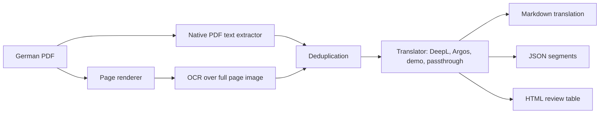

# Technical PDF Translator for Students

[](https://github.com/amandesi13/pdf-de2en-ocr-lens/actions/workflows/ci.yml)
[](https://www.python.org/)
[](https://github.com/tesseract-ocr/tesseract)
[](LICENSE)

German-to-English technical PDF translator for students who need to understand lecture notes, datasheets, lab manuals, research papers, and diagrams without losing the meaning hidden inside figures.

The package name is `pdf-de2en-ocr-lens`, but the product idea is simple: upload a German technical PDF and get an English reading view plus a review table that includes both normal PDF text and OCR text from diagrams, screenshots, labels, and scanned graphics.

## Why Students Need This

Most PDF translators handle selectable text, but technical study material often hides important meaning inside:

- block diagrams
- screenshots
- plotted labels
- scanned pages
- architecture figures
- embedded images

This project treats each page as both a document and an image. It extracts native PDF text, renders each page, OCRs the rendered image, deduplicates overlapping text, translates the German content, and writes reviewable outputs.

It is especially useful for international students in Germany reading technical material in electronics, telecom, embedded systems, computer science, and engineering courses.

## Features

- Native PDF text extraction with page and bounding-box metadata.
- OCR over rendered pages to catch words inside diagrams and graphics.
- Pluggable German-to-English translation:
  - `demo` deterministic mini dictionary for tests and demos.
  - `deepl` for production-quality translation with `DEEPL_API_KEY`.
  - `argos` for local/offline translation.
  - `passthrough` for extraction-only review.
- Outputs:
  - `translation.md` for a clean English reading view.
  - `segments.json` for structured downstream processing.
  - `review.html` for side-by-side German/English inspection.
- CI-ready Python package with tests.

## Architecture



## Installation

```bash
python -m pip install -e ".[ocr,dev]"
```

For OCR, install the Tesseract binary and German language data.

Windows with Chocolatey:

```powershell
choco install tesseract
```

Ubuntu/Debian:

```bash
sudo apt-get install -y tesseract-ocr tesseract-ocr-deu
```

macOS:

```bash
brew install tesseract tesseract-lang
```

## Usage

Demo translator:

```bash
pdf-de2en german-document.pdf -o out --translator demo
```

If Tesseract is installed but not on PATH, pass it explicitly:

```powershell
pdf-de2en german-document.pdf -o out --translator demo --tesseract-cmd "C:\Program Files\Tesseract-OCR\tesseract.exe"
```

If German language data is installed in a custom directory:

```powershell
pdf-de2en german-document.pdf -o out --translator demo --tessdata-dir "C:\Users\you\tools\tessdata"
```

Extraction only:

```bash
pdf-de2en german-document.pdf -o out --translator passthrough
```

DeepL translation:

```bash
export DEEPL_API_KEY="your-key"
pdf-de2en german-document.pdf -o out --translator deepl
```

Disable OCR when the PDF has clean selectable text:

```bash
pdf-de2en german-document.pdf -o out --translator deepl --no-ocr
```

## Output

```text
out/
  translation.md
  segments.json
  review.html
```

`review.html` is useful for technical documents because it keeps OCR confidence, page number, source type, original German, English translation, and bounding boxes together.

## Recruiter-Relevant Engineering Points

This project demonstrates:

- PDF parsing and structured data extraction.
- OCR integration for images and graphics.
- Translation-provider abstraction.
- CLI design and testable pipeline architecture.
- CI with GitHub Actions.
- Practical product thinking for real technical-document workflows.

## Product Direction

This project is the technical-document translation engine that can later plug into broader student tools, such as `auslander-doc-assistant` for German bureaucracy documents or a study assistant for technical PDFs.

## Roadmap

- Add translated PDF overlay generation.
- Add OCR-only-region detection to reduce duplicate text.
- Add Streamlit UI for drag-and-drop conversion.
- Add glossary support for semiconductor and telecom terminology.
- Add batch conversion for folders of PDFs.

## Limitations

- OCR quality depends on Tesseract and the source PDF resolution.
- DeepL requires an API key.
- Argos requires installing the German-to-English language package separately.
- Layout-preserving translated PDFs are not generated yet; the current focus is accurate extraction and reviewable translation.

## License

MIT
